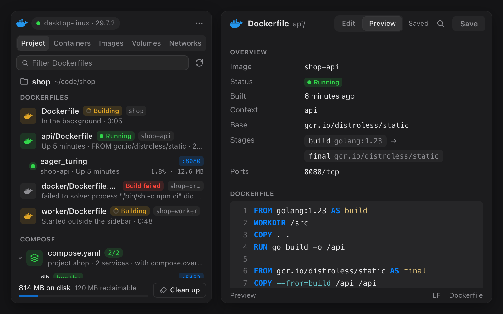

# Docker for Muxy

Manage Docker from a right-hand sidebar in Muxy: your project's Dockerfiles and
Compose files, containers grouped by Compose project, images, volumes, and
networks, with live status, logs, and shells.




## Use it

Click the Docker whale in the top bar, or run **Docker: Toggle Sidebar** from the
command palette (`Ctrl+Opt+D` by default). It opens as a sidebar pinned to the
right of the workspace; use **Pop Out Panel** in its header to float it.

The first time it runs, Muxy asks whether the extension may run `docker`.
Choose **Allow & Remember** so the list can keep itself up to date.

## What it does

- **Project**: finds the Dockerfiles (`Dockerfile`, `Dockerfile.dev`,
  `api.Dockerfile`, `Containerfile`, …) and Compose files in the current
  project, and looks again when you switch projects or add, rename, or edit
  one. Each Dockerfile shows its base image, build stages, exposed ports, and
  whether its image is built, with the containers running from it underneath.
  - **Live status**: a row shows **Building** with a running clock while its
    image builds, **Build failed** with the reason, or **Running** while a
    container from its image is up. Builds started outside the sidebar, like
    `docker compose build` in a terminal, show up too.
  - **Preview and edit**: click a Dockerfile to see it highlighted, with its
    base image, stages, and ports, and a **Build** tab with the last build's
    status and, for background builds, its output. **Edit**, or a line
    number, opens it in the extension's own editor tab, with find (`Cmd+F`)
    and save (`Cmd+S`). The tab has **Edit** and **Preview** modes
    (`Cmd+Shift+V`); the preview shows the overview and live build status,
    including unsaved edits.
  - **Build** or **Build & Run** in a Muxy terminal so you can follow the
    output. Build & Run publishes the ports the Dockerfile exposes and removes
    the container when you stop it. You can also build in the background,
    build a single stage, or run the built image with your own options.
  - Images are named after the project, plus the folder or variant when there
    are several (`shop`, `shop-api`, `shop-dev`). A Dockerfile in a `docker/`
    or `build/` folder builds from the folder above it; others build from
    their own folder. Change either from the row's menu.
  - Compose files show their project name, services, and containers, with
    `up -d`, stop, restart, logs, and `down`.
- **Containers**: grouped by Compose project, with a running count per
  project. Start, stop, restart, pause, and remove containers. Open a shell
  or follow logs in a Muxy terminal tab, and click a published port to open it
  in a Muxy browser tab. Running containers show CPU and memory.
- **Container details**: status, health, command, ports, networks, mounts,
  environment, labels, live resource use, and a log view that follows new
  output.
- **Compose projects**: start, stop, restart, `up -d`, and `down`, plus
  project logs in a terminal.
- **Images**: run (with your own `docker run` options), pull, remove, and
  prune dangling or unused images.
- **Volumes and networks**: see what's in use, remove, and prune.
- **Engine**: shows the current context and engine version, switches
  contexts, starts Docker Desktop when the engine is down, and shows disk usage
  with a one-click clean up (`docker system prune`, volumes kept).

Right-click any row for more actions. Press `/` or `Cmd+F` to filter, and
`Esc` to go back.

## Permissions

| Permission | Why |
| --- | --- |
| `commands:exec` | Runs the `docker` CLI (and `open -a Docker` to start Docker Desktop). |
| `files:read` | Finds Dockerfiles and Compose files in the current project, reads the Dockerfiles, and notices when one is added or changed. |
| `files:write` | Saves the Dockerfile open in the editor tab, only when you save it. Muxy asks before each change. |
| `projects:read` | Reads the current project's name and folder, to name images and show which project the list belongs to. |
| `tabs:write` | Opens terminal tabs for shells, logs, and builds, browser tabs for published ports, and the Dockerfile editor tab, and sets that tab's title and icon. |
| `panels:write` | Opens the sidebar panel from the top bar button and the palette command. |
| `storage:read`, `storage:write` | Remembers the selected tab, filters, collapsed projects, and image names and build folders you set, and shares build status with the editor tab. |

Commands run on the current project's server, so a remote project manages the
Docker engine on that machine.

### Notes for reviewers

- **`commands:exec`**: every call is in `sidebar/docker.js` and runs the
  `docker` program with an argument list, never a shell: `exec` uses
  `muxy.exec(["docker", ...args])`, and `startBuild` uses `muxy.execAsync`
  so a background build can be cancelled. So Muxy's
  **Allow & Remember** for `docker` covers them all, and container or image
  names can't be interpreted as shell syntax. The only other program is
  `open -a Docker`, run when you click **Start Docker Desktop**.
- **Terminal tabs**: **Open Shell** and **Logs in Terminal** open a Muxy
  terminal running `docker exec -it <name> sh`, `docker logs -f <name>`, or
  `docker compose -p <project> logs -f`. Names are quoted with `shq` in
  `sidebar/docker.js`, and Muxy asks before running each command.
- **Project files** are read through `muxy.files` in `sidebar/project.js`.
  The only write is `muxy.files.write` in `save` (`sidebar/editor.js`), for
  the Dockerfile open in the editor tab, when you save it. The search goes at
  most five folders deep and 600 folders in total, and skips Git-ignored
  folders, dot folders (except `.devcontainer` and `.docker`),
  `node_modules`, `vendor`, and other build output. Only Dockerfiles are
  opened. Compose files are read by `docker compose config`, run from the
  file's folder.
- **Build status** comes from `docker buildx history ls` and `inspect`, run
  every few seconds while the Project tab or a Dockerfile is open. Docker
  versions without build history fall back to watching for the new image.
  Background builds use `muxy.execAsync`, so they can be cancelled.
- **Builds** in a terminal run `docker build -t <name> -f <Dockerfile> <folder>`,
  and Build & Run adds `&& docker run --rm -it -p <port>:<port> <name>`.
  Paths are relative to the project and quoted with `shq`.
- **Destructive actions** (remove, `compose down`, prunes, clean up) always ask
  for confirmation first. Clean up never removes volumes.
- **Network**: the pages make no web requests. Clicking a published port opens
  `http://localhost:<port>` in a Muxy browser tab.
- **Context switching** runs `docker context use`, which changes the current
  context for the docker CLI too. The picker says so.

## Development

There's nothing to compile: the sidebar is plain HTML, CSS and JS.
`npm run build` copies it into `dist/`, which is what Muxy loads and the store
publishes, so run it after every edit.

```bash
npm run build
muxy extension load ~/Desktop/docker-extension     # first time
muxy extension enable docker-extension             # first time
muxy extension reload docker-extension             # after each build
muxy extension logs docker-extension --lines 50
```

Icons are adapted from [Lucide](https://lucide.dev) (ISC License). The Docker
whale comes from [Simple Icons](https://simpleicons.org) (CC0). Docker and the
Docker logo are trademarks of Docker, Inc. This extension isn't affiliated with
or endorsed by Docker, Inc.
