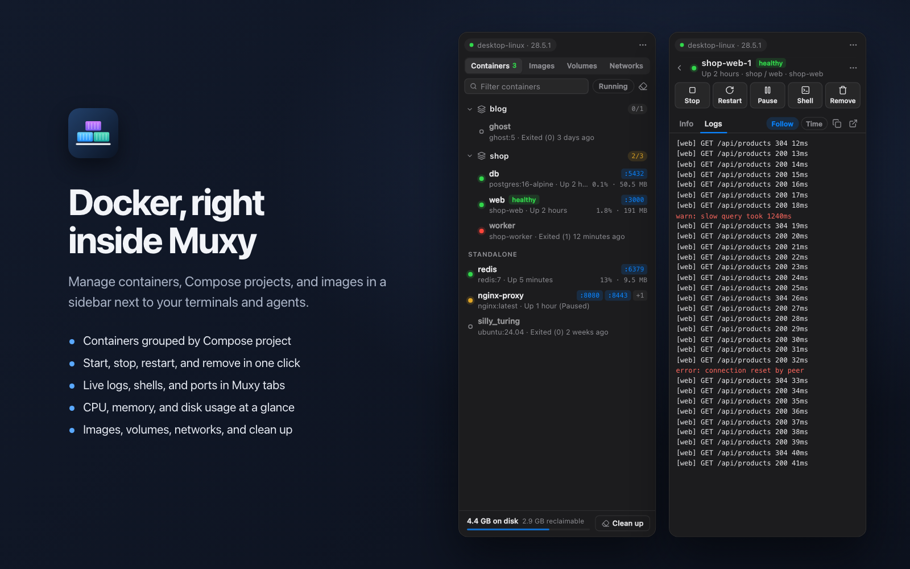

# Docker for Muxy

Manage Docker from a right-hand sidebar in Muxy: containers grouped by Compose project,
images, volumes, and networks, with live status, logs, and shells.



## Use it

Click the box icon in the top bar, or run **Docker: Toggle Sidebar** from the
command palette (`Ctrl+Opt+D` by default). It opens as a sidebar pinned to the
right of the workspace; use **Pop Out Panel** in its header to float it.

The first time it runs, Muxy asks whether the extension may run `docker`.
Choose **Allow & Remember** so the list can keep itself up to date.

## What it does

- **Containers**: grouped by Compose project, with a running count per
  project. Start, stop, restart, pause, and remove containers. Open a shell
  or follow logs in a Muxy terminal tab, and click a published port to open it
  in a Muxy browser tab. Running containers show CPU and memory.
- **Container details**: status, health, command, ports, networks, mounts,
  environment, labels, live resource use, and a log view that follows new
  output.
- **Compose projects**: start, stop, restart, `up -d`, and `down`, plus
  project logs in a terminal.
- **Images**: run (with your own `docker run` options), pull, remove, and
  prune dangling or unused images.
- **Volumes and networks**: see what's in use, remove, and prune.
- **Engine**: shows the current context and engine version, switches
  contexts, starts Docker Desktop when the engine is down, and shows disk usage
  with a one-click clean up (`docker system prune`, volumes kept).

Right-click any row for more actions. Press `/` or `Cmd+F` to filter, and
`Esc` to go back.

## Permissions

| Permission | Why |
| --- | --- |
| `commands:exec` | Runs the `docker` CLI (and `open -a Docker` to start Docker Desktop). |
| `tabs:write` | Opens terminal tabs for shells and logs, and browser tabs for published ports. |
| `panels:write` | Opens the sidebar panel from the top bar button and the palette command. |
| `storage:read`, `storage:write` | Remembers the selected tab, filters, and collapsed projects. |

Commands run on the current project's server, so a remote project manages the
Docker engine on that machine.

### Notes for reviewers

- **`commands:exec`**: every call goes through one function, `exec` in
  `sidebar/docker.js`, which runs the `docker` program with an argument list
  (`muxy.exec(["docker", ...args])`), never a shell. So Muxy's
  **Allow & Remember** for `docker` covers them all, and container or image
  names can't be interpreted as shell syntax. The only other program is
  `open -a Docker`, run when you click **Start Docker Desktop**.
- **Terminal tabs**: **Open Shell** and **Logs in Terminal** open a Muxy
  terminal running `docker exec -it <name> sh`, `docker logs -f <name>`, or
  `docker compose -p <project> logs -f`. Names are quoted with `shq` in
  `sidebar/docker.js`, and Muxy asks before running each command.
- **Destructive actions** (remove, `compose down`, prunes, clean up) always ask
  for confirmation first. Clean up never removes volumes.
- **Network**: the pages make no web requests. Clicking a published port opens
  `http://localhost:<port>` in a Muxy browser tab.
- **Context switching** runs `docker context use`, which changes the current
  context for the docker CLI too. The picker says so.

## Development

There's nothing to compile: the sidebar is plain HTML, CSS and JS.
`npm run build` copies it into `dist/`, which is what Muxy loads and the store
publishes, so run it after every edit.

```bash
npm run build
muxy extension load ~/Desktop/docker-extension     # first time
muxy extension enable docker-extension             # first time
muxy extension reload docker-extension             # after each build
muxy extension logs docker-extension --lines 50
```

Icons are adapted from [Lucide](https://lucide.dev) (ISC License).
