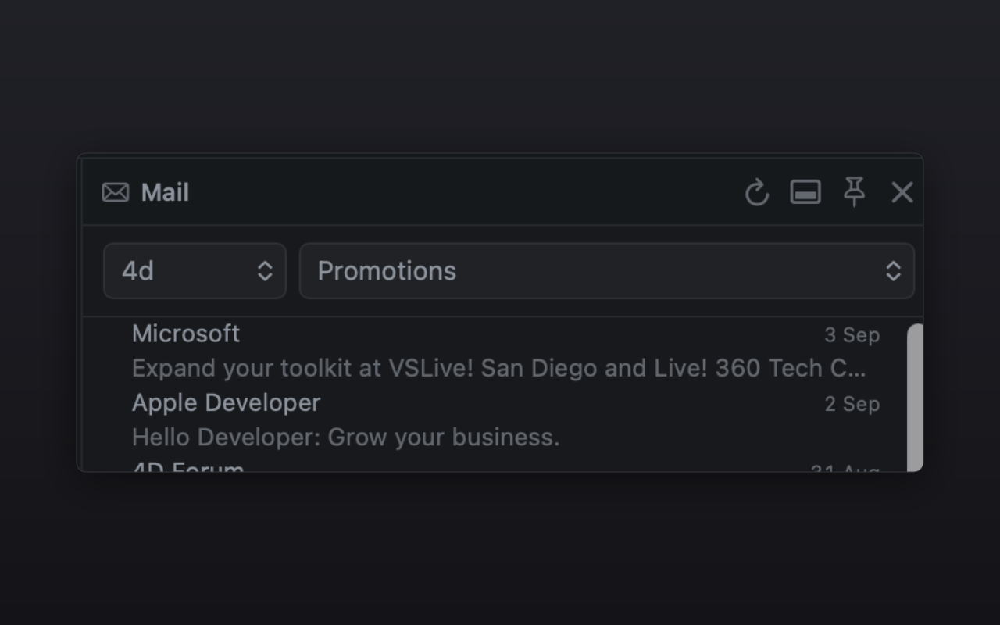

# Mail (Himalaya)

Browse and read your email from a Muxy side panel, powered by the
[Himalaya](https://github.com/pimalaya/himalaya) command-line email client.

Pick an account and a mailbox, scan the envelope list (unread messages are
marked with an accent dot), page through, and click any message to read it
inline. Works with any backend Himalaya supports — IMAP, JMAP, Gmail, Maildir,
and more.

## Viewing a message

Each message opens in **Text** mode by default — Himalaya's plain-text reader,
which never renders remote markup. A **Text / HTML / Reader** switch lets you
choose how to read it:

- **Text** — Himalaya's plain output (headers + decoded text parts). The safe
  default.
- **HTML** — renders the message's real HTML, for when you trust the sender.
  It loads lazily (only when you press it) inside a **locked-down sandboxed
  iframe**: scripts, plugins, forms, and top-navigation are blocked by both the
  `sandbox` attribute and a Content-Security-Policy. Remote images *can* load —
  that's the trade-off you opt into by pressing HTML — so it stays off by
  default.
- **Reader** — strips the HTML down to clean, readable text (links kept as
  `label (url)`, lists as bullets), the way a terminal mail reader shows it. No
  remote content is loaded.

HTML and Reader parse the raw message (`himalaya message read --raw`) locally in
the panel; nothing is sent anywhere.

## Actions

Open a message and use the action bar:

- **Copy content** — copies the message to the clipboard (handy for pasting
  into an AI prompt). It copies whatever form you're viewing: plain **Text**,
  the stripped **Reader** text, or the raw **HTML**. **Right-click the button**
  to pick a form explicitly — *Copy text*, *Copy stripped text (reader)*, or
  *Copy HTML source* — regardless of the current view.
- **Mark as unread** — clears the `Seen` flag.
- **Archive** — moves it to your Archive mailbox (auto-detected; falls back to
  the Move picker if you don't have one).
- **Move to…** — pick a target mailbox from the native picker.
- **Delete** — asks for confirmation, then deletes (Trash on IMAP).

**Right-click any message** in the list to copy Himalaya references for AI
prompts, without leaving the panel:

- **Copy message ID** — the raw backend id.
- **Copy reply command** — e.g. `himalaya message reply -a work -m INBOX 101`.
- **Copy read command** — e.g. `himalaya message read -a work -m INBOX 101`.

So you can paste *"use himalaya to reply to `himalaya message reply -a work -m
INBOX 101` saying …"* straight into an assistant.



## Requirements

This extension is a front-end for the Himalaya CLI — it does not talk to mail
servers itself. You need Himalaya **installed and configured** first:

```bash
brew install himalaya      # or see the Himalaya install docs
himalaya configure         # interactive setup wizard for your first account
```

Once `himalaya account list` works in your terminal, open the **Mail** panel
(topbar icon, status bar, or `⌘⇧M`) and your accounts and mailboxes appear.

## Settings

- **Default account** — account name to open on load. Empty uses Himalaya's
  default account.
- **Messages per page** — envelopes fetched per page (default 25).
- **Himalaya binary path** — full path to the `himalaya` executable. Leave empty
  to auto-detect it on your `PATH` and in common install locations (Homebrew,
  `~/.local/bin` via `PATH`, `/usr/bin`, Nix).

## Permissions

- `commands:exec` — runs the `himalaya` CLI (`account list`, `mailbox list`,
  `envelope list`, `message read`, and the mutating `message move` / `copy` /
  `delete` and `flag add` / `remove`) to fetch, display, and act on your mail.
  All read calls use Himalaya's `--json` output where available; message bodies
  use its plain-text reader. The extension never sends your mail anywhere — it
  only shells out to the local `himalaya` binary you configured.
- `panels:write` — renders the Mail side panel.

## How it works

Everything runs on demand through `muxy.exec`:

| Action | Command |
| --- | --- |
| List accounts | `himalaya --json account list` |
| List mailboxes | `himalaya --json mailbox list` |
| List envelopes | `himalaya --json envelope list --mailbox <box> --page <n> --page-size <n>` |
| Read a message | `himalaya message read <id> --mailbox <box>` |
| Read raw (HTML/Reader) | `himalaya message read --raw <id> --mailbox <box>` |
| Archive / move | `himalaya message move --from <box> --to <target> <id>` |
| Delete | `himalaya message delete --mailbox <box> <id>` |
| Mark unread | `himalaya flag remove --mailbox <box> --flag Seen <id>` |
