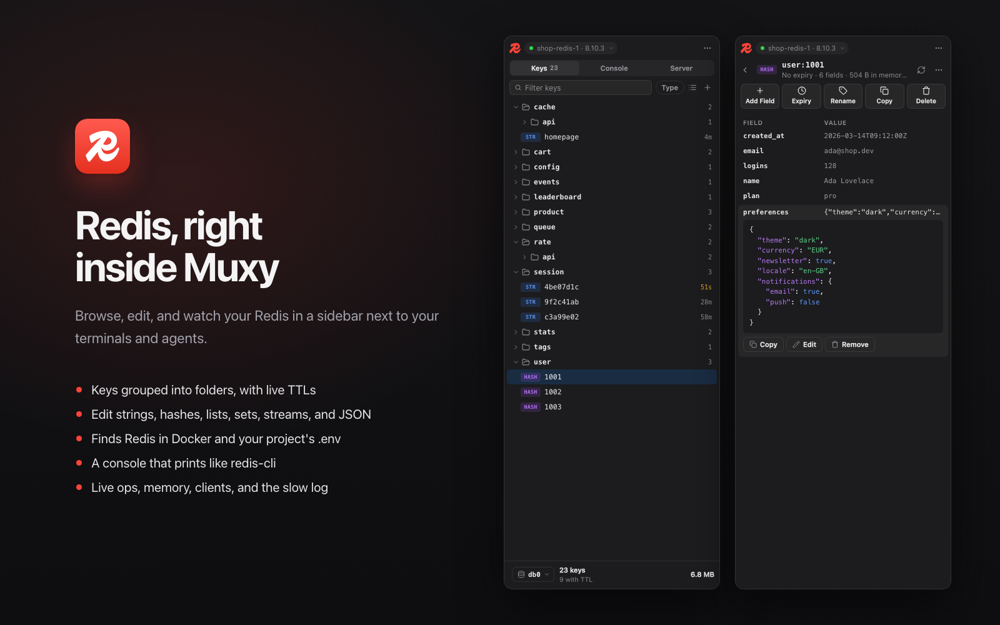
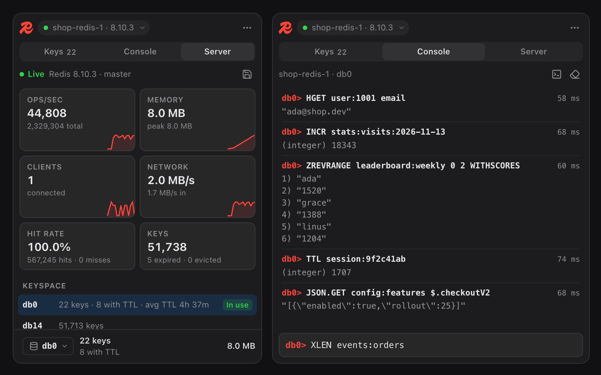

# Redis for Muxy

Browse and edit Redis keys, run commands, and watch server stats from a
right-hand sidebar in Muxy. It finds the Redis servers in your Docker
containers and in your project's `.env`, and works with Valkey, KeyDB, and
Dragonfly too.





## Use it

Click the Redis mark in the top bar, or run **Redis: Toggle Sidebar** from the
command palette (`Ctrl+Opt+R` by default). It opens as a sidebar pinned to the
right of the workspace; use **Pop Out Panel** in its header to float it.

The first time it connects, Muxy asks whether the extension may run a short
shell command (see [How it connects](#how-it-connects)). Choose **Allow &
Remember**: the sidebar uses it for every call.

It starts with **Local** (`127.0.0.1:6379`). Click the connection pill under
the title to switch.

## What it does

- **Connections**: saved servers (host, port, user, password, database, TLS,
  or paste a `redis://` / `rediss://` URL, with **Test**), plus servers it
  finds on its own:
  - **Docker**: running Redis, Valkey, KeyDB, and Dragonfly containers. They
    connect with `docker exec`, so they work without a published port, and
    the password is read from the container's settings
    (`--requirepass "$REDIS_PASSWORD"`, `REDIS_PASSWORD=…`) when it has one.
    Containers from the current project's Compose file are listed first.
  - **This project**: `REDIS_URL` (or any variable holding a `redis://` URL)
    and `REDIS_HOST` / `REDIS_PORT` / `REDIS_PASSWORD` in the project's `.env`
    files. Edits to them show up right away.
  - Each project remembers the connection and database you last picked.
- **Keys**: scans with `SCAN` (never `KEYS`), grouped into folders by `:` or
  as a flat list. Each key shows its type and a live TTL countdown. Filter by
  text or a glob (`user:*`), and by type. Large databases load in pages.
- **Key details**: strings with Auto, Text, JSON, and Hex views (JSON keeps
  big numbers exact); hashes, lists, sets, sorted sets, and streams as rows
  you can expand, filter, edit, add to, and remove from; RedisJSON documents;
  binary values with `\x` escapes. Change the expiry (`90`, `10m`, `2h`,
  `7d`), rename, copy, or delete the key.
- **New keys** of every type, with an optional expiry.
- **Folders**: right-click to filter to a prefix, add a key there, or delete
  every key that matches it.
- **Console**: run any command and see the reply as redis-cli prints it.
  Quotes and `\x` escapes work like redis-cli, `↑` / `↓` go through history,
  and several lines run together on one connection, so `MULTI` … `EXEC`
  works. `SELECT` switches the sidebar's database too.
- **Server**: live ops/sec, memory, clients, and network with sparklines, hit
  rate, keys per database, server, memory, persistence and replication
  details, the busiest commands, connected clients (disconnect one), and the
  slow log. **Save a snapshot** runs `BGSAVE`.
- **Open redis-cli in a Terminal** for `MONITOR`, `SUBSCRIBE`, and other
  commands that keep a connection open. For containers it runs the
  container's own `redis-cli`, so you don't need it installed.
- The footer shows the database (click to switch), its key count, and memory
  use against `maxmemory`.

Right-click any row for more actions. Press `/` or `Cmd+F` to filter, and
`Esc` to go back.

## How it connects

Muxy pages can't open network connections, and the sidebar doesn't need
`redis-cli`. It speaks the Redis protocol itself and sends it through one of
these fixed commands, run with `muxy.exec`:

| Connection | Command |
| --- | --- |
| TCP | `base64 -d \| nc "$MUXY_REDIS_HOST" "$MUXY_REDIS_PORT" \| base64` |
| TLS | `base64 -d \| openssl s_client -quiet -verify 9 -verify_return_error -connect "$MUXY_REDIS_TARGET" … \| base64` |
| Docker | `docker exec -i <container> sh -c 'base64 -d \| nc 127.0.0.1 "$1" \| base64' sh <port>` |

Host and port go in through environment variables, so the command text never
changes and one **Allow & Remember** covers every server. Commands and replies
travel as base64, so binary keys and values come through intact. Each call
opens a connection, sends its commands with a final `QUIT`, and reads the
replies.

`nc`, `base64`, and `openssl` come with macOS and most Linux systems. Inside a
container the sidebar uses BusyBox `nc` (Alpine images) or bash's `/dev/tcp`
(Debian images).

## Permissions

| Permission | Why |
| --- | --- |
| `commands:exec` | Runs the connection commands above, and `docker ps` / `docker container inspect` to find Redis containers. |
| `files:read` | Reads the `.env` files at the project's root to find its Redis, and notices when they change. |
| `projects:read` | Reads the current project's folder, to remember a connection per project and match Compose containers to it. |
| `tabs:write` | Opens a terminal tab running `redis-cli`, only when you ask. |
| `panels:write` | Opens the sidebar from the top bar button and the palette command. |
| `storage:read`, `storage:write` | Remembers saved connections, the last connection and database per project, the console history, and view settings. |

Commands run on the current project's server, so for a remote project
`127.0.0.1` means that machine.

### Notes for reviewers

- **`commands:exec`**: every Redis call goes through `call()` in
  `sidebar/redis.js`. The shell strings are the constants `TCP`, `TLS`, and
  `IN_CONTAINER` there; user input only reaches them as environment variables
  or argv, never as shell text. Docker discovery is `dockerRedisContainers()`
  and `dockerConnInfo()` in the same file.
- **Passwords** for saved connections are kept in the extension's Muxy
  storage, which isn't encrypted. They travel to Redis on stdin, never on a
  command line. Passwords found in a container's or project's settings are
  read when connecting and not stored.
- **Destructive actions** (delete a key, delete keys matching a folder,
  `FLUSHDB`, removing items) always ask first. In the console, `FLUSHALL`,
  `FLUSHDB`, `SHUTDOWN`, `CONFIG SET`, `CLIENT KILL`, and similar commands ask
  before they run.
- **Network**: the pages make no web requests.
- **Load**: the key list refreshes itself only while a database's keys fit in
  one scan of up to 2,000 keys. Server stats refresh every 2 seconds on the
  Server tab and every 10 seconds otherwise, and nothing runs while the
  sidebar is hidden.

## Development

There's nothing to compile: the sidebar is plain HTML, CSS and JS.
`npm run build` copies it into `dist/`, which is what Muxy loads and the store
publishes, so run it after every edit.

```bash
npm run build
muxy extension load ~/Desktop/redis-extension     # first time
muxy extension enable redis-extension             # first time
muxy extension reload redis-extension             # after each build
muxy extension logs redis-extension --lines 50
```

Icons are adapted from [Lucide](https://lucide.dev) (ISC License). The Redis
mark comes from [Simple Icons](https://simpleicons.org) (CC0). Redis and the
Redis logo are trademarks of Redis Ltd. This extension isn't affiliated with
or endorsed by Redis Ltd.
