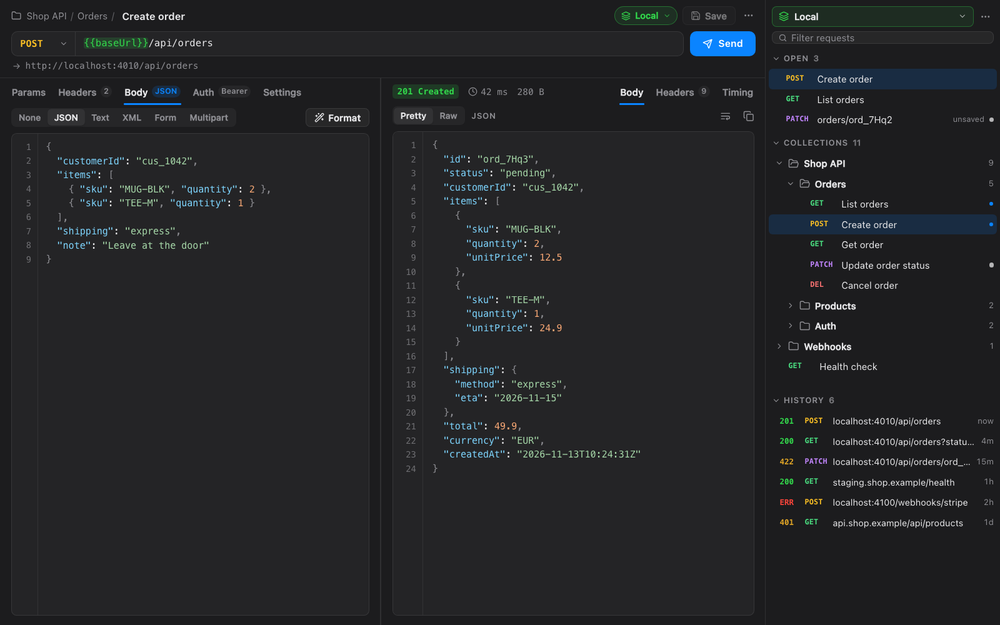
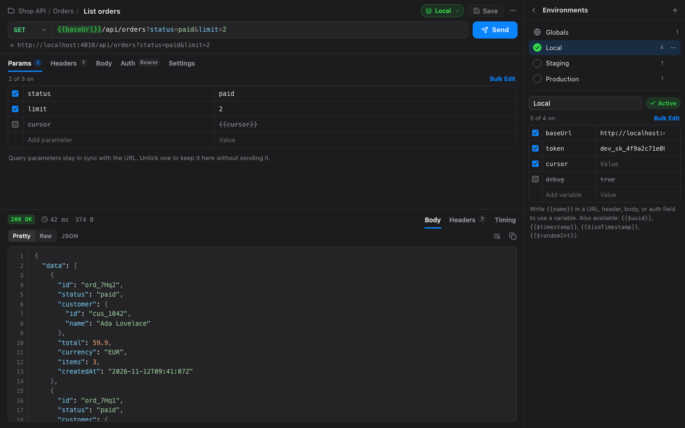

# REST Client for Muxy

An HTTP client inside Muxy. Each request opens as an editor tab next to your
terminals. A sidebar on the right holds your open requests, saved collections
and folders, environments, and history.





## Use it

Click the arrows in the top bar, or run **REST: Toggle Sidebar** from the
command palette (`Ctrl+Opt+H` by default). The sidebar opens pinned to the
right of the workspace.

- **New request**: the **+** in the sidebar's header, or **REST: New Request**
  from the palette. It opens as an unsaved request.
- **Send**: `Cmd+Enter`, or Enter in the URL field. `Esc` cancels.
- **Save**: `Cmd+S`. The first time, it asks for a name and a folder.
- **Import curl**: paste a curl command into the URL field. Browser
  "Copy as cURL" commands work too.

The first send asks whether the extension may run `curl`. Choose
**Allow & Remember**.

## What it does

- **Request tabs**: method, URL, and tabs for **Params** (kept in sync with
  the URL's query string), **Headers** (with suggestions, plus a list of the
  headers sent automatically), **Body**, **Auth**, and **Settings**. One tab
  per request. Use Muxy's tab groups to compare two side by side.
  - **Body**: JSON (with highlighting, a validity check, and **Format**,
    `Cmd+Shift+F`), Text, XML, URL-encoded form, or multipart form with file
    fields.
  - **Auth**: Bearer token (with a custom prefix), Basic, or API key in a
    header or the query string.
  - **Settings**: follow redirects, compressed responses, skip TLS
    verification, and timeout.
- **Responses**: status, time, and size. The body has **Pretty**
  (highlighted JSON, XML, and HTML, with line numbers), **Raw**, and for HTML a
  sandboxed **Preview**. Headers are listed in full. **Timing** breaks the
  request into DNS, TCP, TLS, server wait, and download, with the remote
  address, HTTP version, and the redirect chain.
- **Sidebar**:
  - **Open**: request tabs in the current project, with unsaved changes
    marked. Click to switch tabs. Right-click for Close Others and Close All.
  - **Collections**: folders and saved requests. Drag to reorder or move into
    a folder, double-click a folder to rename it, and right-click for New
    Request Here, Rename, Duplicate, Move to…, and Delete.
  - **History**: the last 100 sends, with status. Click one to open it again
    as a new request.
  - **Filter** (`/` or `Cmd+F`) searches names, URLs, and methods.
- **Environments**: named sets of variables, plus **Globals** that apply in
  every environment. Use `{{name}}` in the URL, headers, body, or auth fields.
  The URL field marks variables green when defined and red when not, and shows
  the resolved URL underneath. `{{$uuid}}`, `{{$timestamp}}`,
  `{{$isoTimestamp}}`, and `{{$randomInt}}` are generated on every send.
  Switch environments from the sidebar or from the pill in any request tab.
- **Copy as cURL** from a request tab's menu, with variables resolved.

Edits are kept as you type, so unsaved changes survive a restart. Closing a
tab with unsaved changes asks whether to save them.

## How requests are sent

Requests go out through `curl` on the project's machine (`muxy.exec`). So
`localhost` and private networks work, and for a remote project the request
comes from the machine where its code runs. If `curl` isn't installed, the
extension falls back to Muxy's own web requests, which can't reach localhost
or private networks and don't support multipart forms.

Bodies are passed as text, so binary responses (images, PDFs) show their type
and size but not their content. Responses over 4 MB are cut off.

## Permissions

| Permission | Why |
| --- | --- |
| `commands:exec` | Runs `curl` to send requests. |
| `tabs:read` | Lists the current project's tabs, so **Open** shows only the request tabs in that project. |
| `tabs:write` | Opens request tabs, switches to them from the sidebar, and sets their titles and icons. |
| `panels:write` | Opens the sidebar from the top bar button, the palette command, and a request tab's **Show in Sidebar** and **Manage Environments**. |
| `storage:read`, `storage:write` | Keeps collections, unsaved edits, environments, history, and view settings. |

It also receives tab, project, and worktree events, to keep **Open** in step
with your tabs.

### Notes for reviewers

- **`commands:exec`**: the only call is in `app/http.js` (`send`). It runs
  the `curl` program with an argument list, never a shell, so Muxy's
  **Allow & Remember** for `curl` covers every request, and nothing in a URL,
  header, or body is read as shell syntax. The body goes through stdin
  (`--data-binary @-`), and `--url` and `--globoff` keep the URL from being
  read as an option or a glob. `muxy.execAsync` lets you cancel a request.
- **Network**: the pages make no requests of their own. They send only the
  requests you send, through `curl`, or through `muxy.http.fetch` when `curl`
  is missing. HTML previews use a sandboxed iframe with scripts off.
- **Background script** (`background.js`): Muxy delivers a page's
  `extension.*` messages to the background script, so it passes them between
  the sidebar and the request tabs, and keeps the list of open request tabs
  from Muxy's tab events. It also opens a new request tab for the
  **REST: New Request** command.
- **Storage**: all data stays in Muxy's extension storage. Nothing is written
  to project files.

## Development

There's nothing to compile: the pages are plain HTML, CSS and JS.
`npm run build` copies them into `dist/`, which is what Muxy loads, so run it
after every edit.

```bash
npm run build
muxy extension load ~/Desktop/rest-client-extension     # first time
muxy extension enable rest-client-extension             # first time
muxy extension reload rest-client-extension             # after each build
muxy extension logs rest-client-extension --lines 50
```

Icons are adapted from [Lucide](https://lucide.dev) (ISC License).
