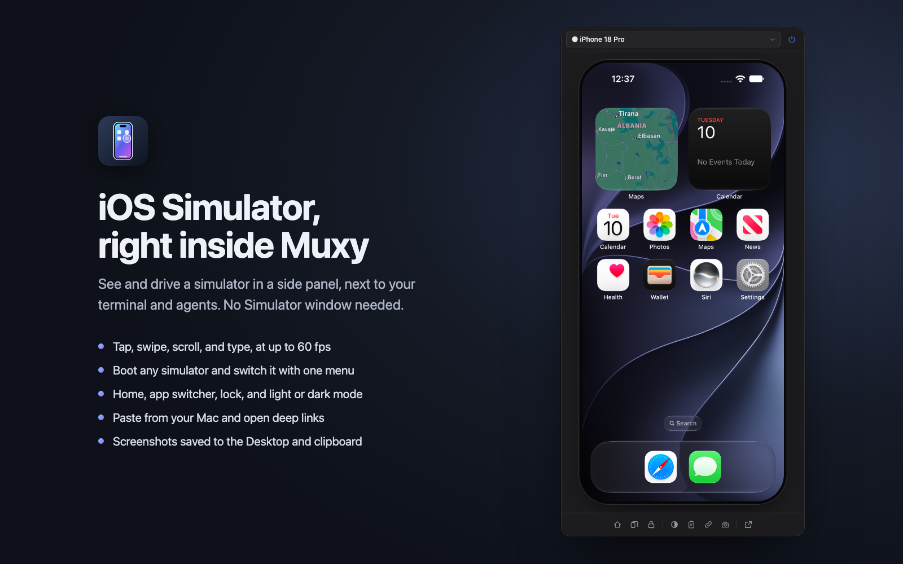

# Simulator for Muxy

An iOS Simulator you can see and touch, in a Muxy side panel. It streams the
simulator's screen at up to 60 fps and sends it your clicks, drags, scrolls and
typing. You don't need a Simulator window.



## Use it

- Click the iPhone icon in the top bar, press `Ctrl+Opt+I`, or run
  **Simulator: Toggle Panel** from the command palette.
- Pick a simulator from the menu at the top. If it's off, the power button
  boots it.
- **Click** to tap, and **drag** to swipe. Drag up from the bottom edge to go
  home.
- **Scroll** with a trackpad or mouse wheel to scroll the app.
- Hold **Option** while dragging to pinch.
- Click the screen, then **type**: keys go to the simulator's hardware keyboard.
  `⌘V` pastes your Mac's clipboard, and `⌘⇧H` goes home.
- The bottom bar has Home, the app switcher, Lock, light/dark appearance, Paste,
  Open URL (for deep links), Screenshot (saved to the Desktop and copied to the
  clipboard), and a button that opens Xcode's own simulator app: Simulator.app
  up to Xcode 26, or Device Hub from Xcode 27.

## How it works

The panel is a plain web page. Pages can't reach the simulator directly, so the
extension includes a small native helper, `helper/simbridge.swift`, shipped as
readable source.

1. When the panel opens, it starts the helper with `muxy.exec`. The first start
   compiles the helper with `xcrun swiftc` into
   `~/Library/Caches/muxy-simulator-extension/`, which takes a couple of seconds.
   Muxy asks you once before running it; choose **Allow & Remember**.
2. The helper listens on `127.0.0.1:47290` and accepts WebSocket connections
   from Muxy extension pages only.
3. It reads the simulator's framebuffer through Xcode's CoreSimulator framework,
   encodes JPEG frames only when the screen changes, and sends each one after
   the panel has drawn the last.
4. Touches, buttons and keys go to the simulator through SimulatorKit's HID
   client, the same path Xcode's simulator app uses.
5. It exits about 30 seconds after the last panel disconnects.

Device management (listing, booting, appearance, URLs, screenshots) uses
`xcrun simctl`.

## Permissions

| Permission | Why |
| --- | --- |
| `commands:exec` | Compile and start the helper. This is the only command the extension runs: one fixed shell script in `panel/app.js` (`LAUNCH_SCRIPT`), so Muxy can remember your answer. |
| `panels:write` | The panel, its command, and the top bar button |
| `storage:read`, `storage:write` | Remember the simulator you picked |

### Notes for reviewers

- **`commands:exec`**: the script compiles `helper/simbridge.swift`, passed on
  stdin, into `~/Library/Caches/muxy-simulator-extension/`, removes older
  builds there, and starts the helper in the background. The source's hash
  names each build, so an edited helper is always recompiled.
- **WebSocket**: the panel connects only to `ws://127.0.0.1:47290`, its own
  helper. Neither the panel nor the helper makes internet requests. The helper
  binds to the loopback address and rejects connections whose `Origin` isn't a
  `muxy-ext://` page, so websites open in a browser can't drive the simulator.
- **Private frameworks**: the helper loads CoreSimulator and SimulatorKit from
  the installed Xcode at runtime, with `dlopen`. Nothing is downloaded.

## Requirements

- macOS with Xcode and at least one simulator runtime installed.
- A local project. `muxy.exec` runs on the project's computer, so this doesn't
  work for remote projects.

The helper relies on private Xcode frameworks. It was built against Xcode 27.2,
and a future Xcode may change them. If streaming stops working after an Xcode
update, the helper's log is
`~/Library/Caches/muxy-simulator-extension/simbridge.log`.

## Developing

`npm run build` copies the extension into `dist/`, which is what Muxy loads
when the folder has one. Build again after every edit.

```bash
npm run build
muxy extension load ~/Desktop/simulator-extension      # once
muxy extension enable simulator-extension              # once
muxy extension reload simulator-extension              # after each build
```

Editing `helper/simbridge.swift` changes its version hash, so the panel
compiles and starts the new helper and stops the old one.
