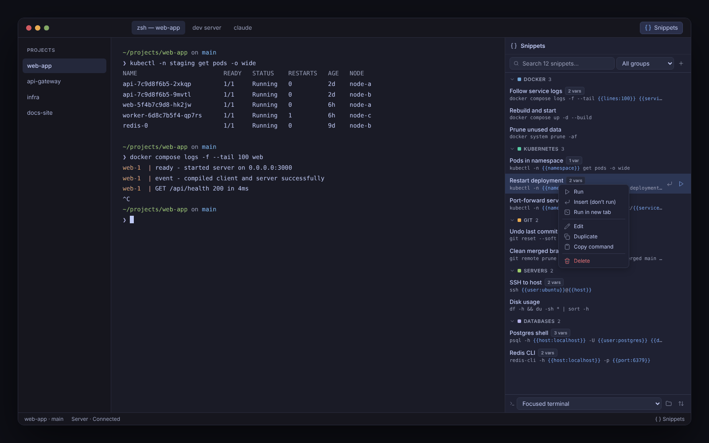

# Snippets

Save, organize and run your frequently used terminal commands from a side panel in [Muxy](https://muxy.app) — no more digging through shell history or notes to find that one long command.

Snippets live in color-coded groups, can contain variables that are filled in at run time, and are sent straight to the terminal you're working in.



## Features

- **Groups** — color-coded, filterable, collapsible and reorderable
- **Three ways to send** — *Run* (type and press Enter), *Insert* (type without running) or *New tab* (run in a fresh terminal tab)
- **Multi-line snippets** — each line runs in order
- **Variables** — `{{name}}` or `{{name:default}}`, prompted before sending; recent values are remembered per snippet
- **Quick run** — Muxy's native picker lists every snippet, most recent first, from anywhere in Muxy (<kbd>⌘</kbd> <kbd>⌥</kbd> <kbd>S</kbd>)
- **Right-click menu** — run, insert, edit, duplicate, copy or delete a snippet in place
- **Secret guard** — warns before you save something that looks like a password, token, API key or URL credential
- **Import / Export** — move snippets between machines as JSON (merge or replace)
- **Target terminal** — send to the focused terminal or pick any open pane

Built with plain JavaScript and Muxy's shared UI kit ([`@muxy/ui`](https://github.com/muxy-app/extensions/tree/main/shared/ui)), so it looks and behaves like the official extensions. No runtime dependencies and no network access.

## Installation

### From source

Requires Node.js 20 or newer and git.

```bash
git clone https://github.com/cibofdevs/snippets.git
cd snippets
npm install
npm run setup:ui   # downloads @muxy/ui (shared/ui from muxy-app/extensions)
npm run build      # outputs dist/
```

Then in Muxy:

1. Open **Settings → Extensions** and choose **Load Unpacked…**.
2. Select the `snippets` folder. Muxy loads the build from `dist/`.
3. Enable the extension — Muxy installs extensions disabled by default.
4. Open the panel with the `{ }` icon in the top bar or press <kbd>⌘</kbd> <kbd>⇧</kbd> <kbd>S</kbd>.

The first time a snippet types into a terminal or opens a tab with a command, Muxy asks you to allow it.

## Usage

### Create a snippet

Click **New**, give the snippet a name, enter one or more commands and choose a group. Pick a **default action** — it is used when you double-click the snippet and when you pick it in Quick run.

### Variables

Wrap any value that changes between runs in double braces:

```bash
ssh {{user:ubuntu}}@{{host}}
docker compose logs -f --tail {{lines:100}} {{service}}
kubectl -n {{namespace}} rollout restart deployment/{{deployment}}
```

- `{{host}}` is required and asked every time it has no remembered value.
- `{{lines:100}}` falls back to `100` when left empty.
- Values are remembered per snippet, **except** for variables whose name contains `pass`, `pwd`, `secret`, `token` or `key`. Those are never stored, and the panel masks them while you type.
- In the panel, all variables are asked in one form. Quick run asks for them one by one with Muxy's native prompt; leave a prompt empty to use the value shown as its placeholder. Native prompts do not mask input.

### Run a snippet

| Action | How |
|---|---|
| Run | ▶ button, right-click → **Run**, or double-click (when *Run* is the default) |
| Insert without running | ↩ button or right-click → **Insert** |
| Run in a new tab | Right-click → **Run in new tab**, or set *New tab* as the snippet's default action |
| From anywhere | <kbd>⌘</kbd> <kbd>⌥</kbd> <kbd>S</kbd> opens **Quick run**: pick a snippet and it runs with its default action |
| Edit, duplicate, copy, delete | Right-click the snippet |

### Keyboard shortcuts

| Where | Shortcut | Action |
|---|---|---|
| Anywhere | <kbd>⌘</kbd> <kbd>⇧</kbd> <kbd>S</kbd> | Toggle the Snippets panel |
| Anywhere | <kbd>⌘</kbd> <kbd>⌥</kbd> <kbd>S</kbd> | Quick run (native picker) |
| Panel | <kbd>/</kbd> | Focus search |
| Panel search | <kbd>↵</kbd> / <kbd>⌥</kbd> <kbd>↵</kbd> | Run / insert the top result |
| Snippet row | <kbd>⇧</kbd> <kbd>F10</kbd> | Open the context menu |
| Editor | <kbd>⌘</kbd> <kbd>↵</kbd> | Save |
| Variables form | <kbd>↵</kbd> · <kbd>⌥</kbd> <kbd>↵</kbd> · <kbd>⌘</kbd> <kbd>↵</kbd> | Default action · insert · new tab |
| Editor, forms | <kbd>Esc</kbd> | Back to the list |

Shortcuts can be changed in **Settings → Keyboard**.

## Permissions

| Permission | Why it's needed |
|---|---|
| `storage:read`, `storage:write` | Save your snippets and groups |
| `panes:read` | List open terminals so you can choose where a snippet is sent |
| `panes:write` | Type the snippet into the selected terminal |
| `tabs:write` | Open a new terminal tab for *Run in new tab* |
| `panels:write` | Show the Snippets panel and its top bar button |
| `commands:run-script` | Run Quick run, which opens Muxy's native picker and prompts |
| `notifications:write` | Confirm when a snippet was sent |

The extension makes no network requests and does not run programs on its own — every command is typed into a terminal you can see.

## Data and privacy

Snippets are stored locally with Muxy's extension storage as **unencrypted JSON**. They stay on your machine and are kept if the extension is uninstalled.

**Do not store secrets in snippets.** Use a variable such as `{{password}}` and type the value when you run it. The editor warns you when a command looks like it contains a credential.

### Import / Export format

Use **Import / Export** at the bottom of the panel to back up or move snippets. Importing can *merge* (groups are matched by name, snippets by ID) or *replace* everything.

```json
{
  "version": 1,
  "groups": [
    { "id": "g_docker", "name": "Docker", "color": "#7aa2f7" }
  ],
  "snippets": [
    {
      "id": "s_logs",
      "groupId": "g_docker",
      "name": "Follow service logs",
      "command": "docker compose logs -f --tail {{lines:100}} {{service}}",
      "action": "run",
      "description": ""
    }
  ]
}
```

## Development

```bash
npm install
npm run setup:ui  # once; not needed inside the muxy-app/extensions monorepo
npm run dev       # Vite dev server — open /panel/index.html
npm run build     # production build into dist/ (what Muxy installs)
npm test          # unit tests for the core logic
npm run test:ui   # panel (jsdom) and Quick run tests against a mocked Muxy API
```

Outside Muxy, the pages fall back to a mock API backed by `localStorage` and a dark development theme, so you can work on the UI in any browser.

Muxy loads from `dist/`, so run `npm run build` and press **Reload** in **Settings → Extensions** after each change. Errors and `console` output appear on the extension's page in Settings.

### Where `@muxy/ui` comes from

The UI is built on `shared/ui` from [muxy-app/extensions](https://github.com/muxy-app/extensions), which is not published to npm. `scripts/muxy-ui.mjs` looks for it in this order:

1. `MUXY_UI_DIR`, if set
2. `../../shared/ui` — when this folder lives in `extensions/` of the marketplace monorepo
3. `.muxy-ui/shared/ui` — downloaded by `npm run setup:ui` (git-ignored)

### Project structure

```
package.json            Manifest — permissions, panel, commands, top bar item, marketplace listing
vite.config.js          Builds the panel into dist/; aliases @ → src and @muxy/ui → shared/ui
vite.quick-run.config.js Bundles the Quick run script into dist/quick-run.js
panel/index.html        Snippets panel entry
src/
  lib/core.js           Pure logic: data model, variables, search, secret detection, import/export
  lib/bridge.js         All calls to the Muxy API, plus the browser mock
  lib/icons.js          Lucide icons rendered with @muxy/ui's icon()
  panel/                Panel controller and styles
  quick-run/            Quick run command (native picker + prompts)
  styles/global.css     Page chrome shared by both pages
public/assets/          Listing icon and screenshots (copied into dist/ as-is)
scripts/                copy-manifest, @muxy/ui lookup and setup
test/                   Unit tests, UI tests, fixtures
```

## Known limitations

- Muxy can only type into terminals that are **visible** on screen.
- *Run in new tab* works for local projects only.
- Snippets are not synced between machines; use Export / Import.

## Contributing

Issues and pull requests are welcome. Please run `npm test` and `npm run test:ui` before opening a pull request, keep Muxy API calls inside `src/lib/bridge.js`, and prefer `@muxy/ui` primitives over custom styles.

## License

[MIT](LICENSE). Icons are from [Lucide](https://lucide.dev) (ISC).
